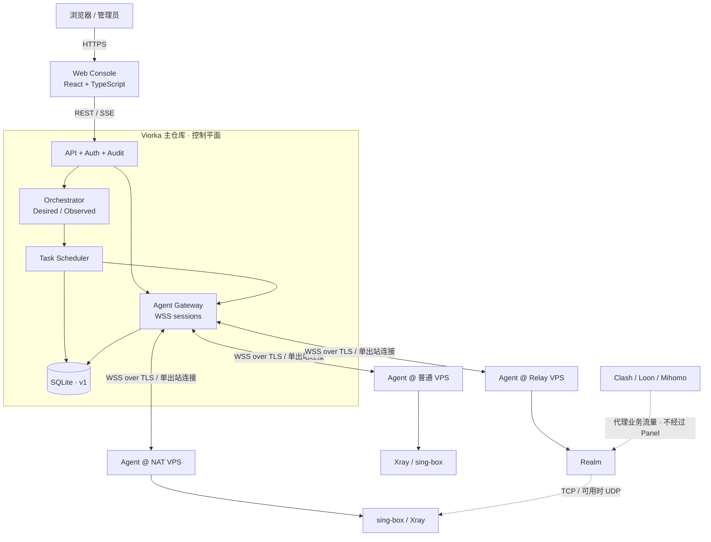
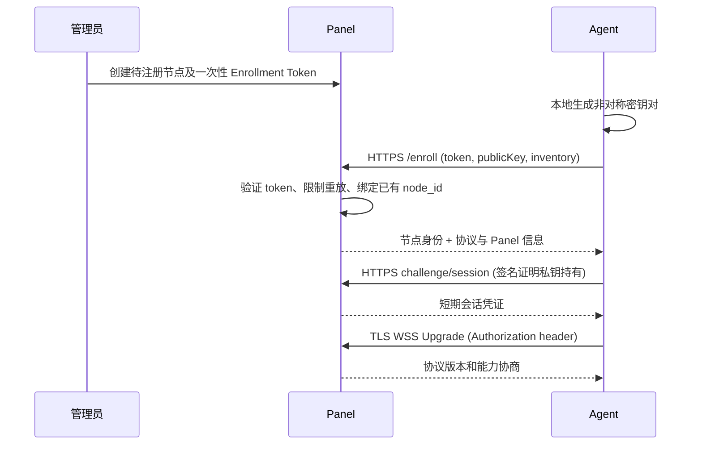
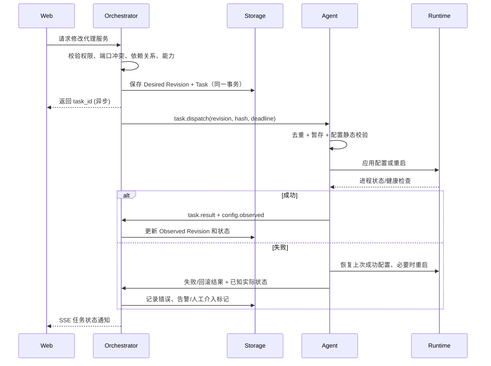

# Viorka 总体架构设计（v0.1）

> 状态：**目标架构 / 设计基线**，并非已完成功能说明。维护者：Viorka 项目。2026-10-29。

## 1. 产品定义

Viorka 是 Vioira 旗下同时面向 **基础设施管理** 和 **代理服务编排** 的开源管理平台。它将公网 VPS、NAT VPS、端口映射、代理引擎、网络中转链路抽象为可观察、可审计、可声明式部署的资源。

### 目标

- 单机快速部署：Panel 为一个 Go 进程，默认 SQLite，无 Redis/NATS 等强制依赖。
- Agent 独立仓库：能在低配 Linux VPS、NAT VPS 上运行，主动出站，TLS/WSS 单连接复用。
- 同一节点管理多种能力：系统资产、地址与端口、sing-box、Xray 和 Realm。
- 可恢复发布：希望运行的配置（Desired）与观察到的配置（Observed）分离，具备版本、结果反馈、回滚。
- 安全隔离：控制平面不代理用户流量；Panel 失联不影响已经运行的本地服务。
- 演进空间：后续能独立拆出 Worker/Gateway、PostgreSQL 和横向扩容。

### 非目标（v1 不做）

- 自研代理协议或代理数据转发核心；替代 sing-box / Xray / Realm。
- Kubernetes、分布式调度器、全网流量网关、全功能虚拟化管理。
- 默认任意 Shell / SSH 远程控制；用户输入直接拼接 root 命令。
- 在无服务商权限时自动新增 NAT 提供商的公网映射端口。
- 宣称配置变更零中断：部分代理引擎/操作需要进程重启。

## 2. 组件架构



> M0 已实现认证、SQLite、注册/WSS、只读 node.inspect 任务和 SSE；Agent 提供 enroll/run。配置编排、引擎管理、监控和订阅仍属规划。实际范围见 [GETTING_STARTED.md](GETTING_STARTED.md)。

## 3. 仓库分界

| 仓库 | 拥有的职责 | 不承担的职责 |
|---|---|---|
| `viorka` | Web、用户和 RBAC、资产模型、统一配置源、调度、历史、订阅、审计、REST、Agent Gateway | 不在 Panel 上接管全部节点的代理业务流量；不侵入节点现有第三方配置 |
| `viorka-agent` | 本地资产探测、服务执行、引擎生命周期、配置验证与回滚、本地缓存和身份保管 | 不保存中央用户权限模型；不负责多个节点的全局策略/调度 |

两个仓库独立发布，例如 `viorka v1.3.x` 和 `viorka-agent v1.1.x` 可以共存。协议由主仓库 `api/agent/v1` 定义，Agent 从打标签的 Schema 生成代码；详见 [REPOSITORIES.md](REPOSITORIES.md)。

## 4. 后端：模块化单体

单一 Go Server 进程内采用清晰模块：

1. `auth`：身份、会话、角色、Agent 凭证；Web 用户与节点身份分离。
2. `inventory`：nodes、addresses、port_allocations、可用 TCP/UDP 与权限能力。
3. `gateway`：连接接入、在线索引、流控、心跳、重连，不把业务逻辑塞进 socket handler。
4. `proxy`：引擎/服务配置抽象，处理配置协议和版本语义。
5. `orchestrator`：Desired/Observed、资源依赖图、配置生成与调和（reconciliation）。
6. `scheduler`：可靠任务、去重、重试、补偿和超时；任务先持久化再派发。
7. `telemetry`：实时聚合、前端 SSE、历史分钟桶，避免原始秒级采样直接写 SQLite。
8. `subscription`：可选择性输出兼容 Mihomo、Clash、Loon 的客户端配置/订阅。
9. `storage`：初期 SQLite，使用接口为 PostgreSQL 迁移保留边界。

**原则**：每个模块自己的领域接口/模型可以独立测试；跨模块通过服务接口或领域事件协作；HTTP Handler 不应直接调用 SSH/系统命令。

## 5. Agent：控制器，不是代理转发服务器

单个 Agent 常驻 VPS/NAT 节点：

- 向 Panel 主动建立一个加密的 WSS 双向连接；不要求 Agent 入站监听。
- 本地可缓存最后一次成功运行的配置与 Revision。
- 接收明确列入白名单的任务，如 `engine.install`、`engine.restart`、`proxy.apply`、`port.inspect`。
- 原子写入配置、先校验，再应用并检查健康；可回到上一个成功版本。
- 不在日志和状态上报中输出代理私钥、REALITY 私钥或一次性注册凭证。
- Alpine/OpenRC、Debian/systemd、没有 init 的受限容器分别使用进程监督适配器。

**Agent 不主动改变非 Viorka 管理的服务**。初次发现已安装 Xray/sing-box 时只以 `observed` 模式展示；用户授权接管后才切换为 `managed`。

## 6. 连接与数据流

### 6.1 节点注册



注册 Token 只用于一次性绑定；正式会话凭证可吊销、可轮换，不能放入 URL 查询参数。详细见 [PROTOCOL.md](PROTOCOL.md)。

### 6.2 配置发布 / 调和



**关键不变量**：配置提交只表示 Desired 状态已保存；必须等待 Agent 的 Observed 状态和健康检查，才能认定发布成功。

### 6.3 SSE 与指标

Agent 上报可配置频率的节点指标（初始建议 30～60 秒），Panel 做实时缓存 + 分钟级归档，前端用 SSE 订阅任务与监控快照。SSE 连接只在浏览器与 Panel 之间发生；浏览器不能直接向 Agent 下发命令。

## 7. 核心资源模型

```text
Node
 ├── NodeAddress[*]          (公网 / 内网 IPv4/IPv6 / 域名)
 ├── PortAllocation[*]       (公网:端口 → 内网:端口, TCP/UDP, 映射归属)
 ├── Engine[*]               (sing-box / Xray / Realm, observed/managed)
 │    ├── ProxyService[*]    (入站、认证/传输/路由策略)
 │    └── RelayRule[*]       (入站 → 上游)
 ├── ConfigRevision[*]       (不可变期望配置版本)
 ├── Deployment[*]           (每资源的 Desired/Observed)
 ├── Task[*]                 (执行链路和幂等键)
 └── MetricRollup[*]         (按时间桶聚合)
```

实际表见 [DATABASE.md](DATABASE.md) 和 `../migrations/0001_init.up.sql`。配置中的敏感字段需要加密存储，不要直接拿数据库备份当可公开样例。

## 8. NAT 与链路编排

- 以 **端口映射资源** 而不是简单的 `is_nat=true` 表示 NAT 属性：公网 Host/Port、内网 Host/Port、协议、归属和 provider。
- 提供商分配端口：Agent 不能凭空修改服务商的公网映射；Panel 仅记录已授权端口，或者通过专门的 Provider Adapter 调服务商 API。
- 用户建立 `入口节点 → Relay → 出口节点` 关系时，Orchestrator 验证端口、方向、协议能力和节点可达性。
- 无 UDP、禁用 QUIC 的 NAT 节点默认只部署 TCP 服务；对 UDP 的允许必须基于能力探测和明确授权。
- 端口冲突检查必须考虑 `listen_host`、TCP/UDP 和同一节点多个服务。
- Realm 原则上是透明中转，应用层 TLS/REALITY 在目标端处理；中转本身不持有目标代理身份密钥。

详细参见 [NAT_AND_RELAY.md](NAT_AND_RELAY.md)。

## 9. 可靠性与故障模型

| 故障 | 预期处理 |
|---|---|
| Panel 意外重启 | Agent 重连并重新报告本地运行配置；Panel 从任务表恢复状态 |
| Agent 短暂掉线 | Panel 将节点标记离线；已有服务保持运行；待恢复后按版本补发 |
| 任务重复投递 | `(node_id, idempotency_key)` 去重；本地保留已执行结果避免重复副作用 |
| 配置校验失败 | 保留旧版本，不执行切换 |
| 引擎重启失败 | 尝试原子回滚并上报失败；不能恢复则进入 degraded，告警而非假称成功 |
| Panel/Agent 版本不匹配 | 能力与版本协商，不支持的操作明确拒绝 |
| SQLite 写锁争用 | 限制监控写入、短事务、WAL、Busy Timeout；达到上限时迁移 PG |
| 服务商公网映射变化 | 将映射标记疑似失效，提示用户/Provider Adapter 重新同步 |

## 10. 安全边界

- 控制接口认证、RBAC、审计，危险操作二次确认；Web 用户与 Agent 身份分离。
- HTTPS/WSS 强制 TLS，令牌不放 URL，按节点吊销密钥，客户端不得禁用证书验证。
- Agent 禁止自由拼接 shell 命令；任务白名单、限定参数路径、超时、并发限流。
- 代理密钥加密存储、备份加密、日志脱敏；只记录配置摘要和修订号。
- 已有第三方引擎默认只读，明确 opt-in 后才能接管。

详见 [SECURITY.md](SECURITY.md)。

## 11. 规模演进

| 阶段 | 部署方式 | 存储/队列 | 触发条件 |
|---|---|---|---|
| v1 | 单 Panel 进程 + 多 Agent | SQLite + DB task table | 起步默认 |
| v2 | API/Gateway + Worker 可分离 | PostgreSQL + 可靠派发 | 单机资源/锁争用明显或需要独立扩容任务执行 |
| v3 | 多 Gateway/多 Worker | PostgreSQL + 具备持久化语义的消息系统 | 高可用、跨机房多实例、服务发现需求成熟 |

**不要**先为 v3 添加复杂中间件再开始 M0。应先实现正确的状态机、幂等与协议版本，再替换部署形态。

## 12. 已实现与未实现清单

已实现：SQLite 迁移/持久化、用户登录和实例级角色、Agent 注册/签名会话/WSS/重连/吊销、只读任务、Web 登录/注册与 SSE。尚未实现：引擎管理、Desired/Observed 发布回滚、分钟指标、订阅和 Relay。验收细节见 [GETTING_STARTED.md](GETTING_STARTED.md)，阶段状态见 [ROADMAP.md](ROADMAP.md)。
