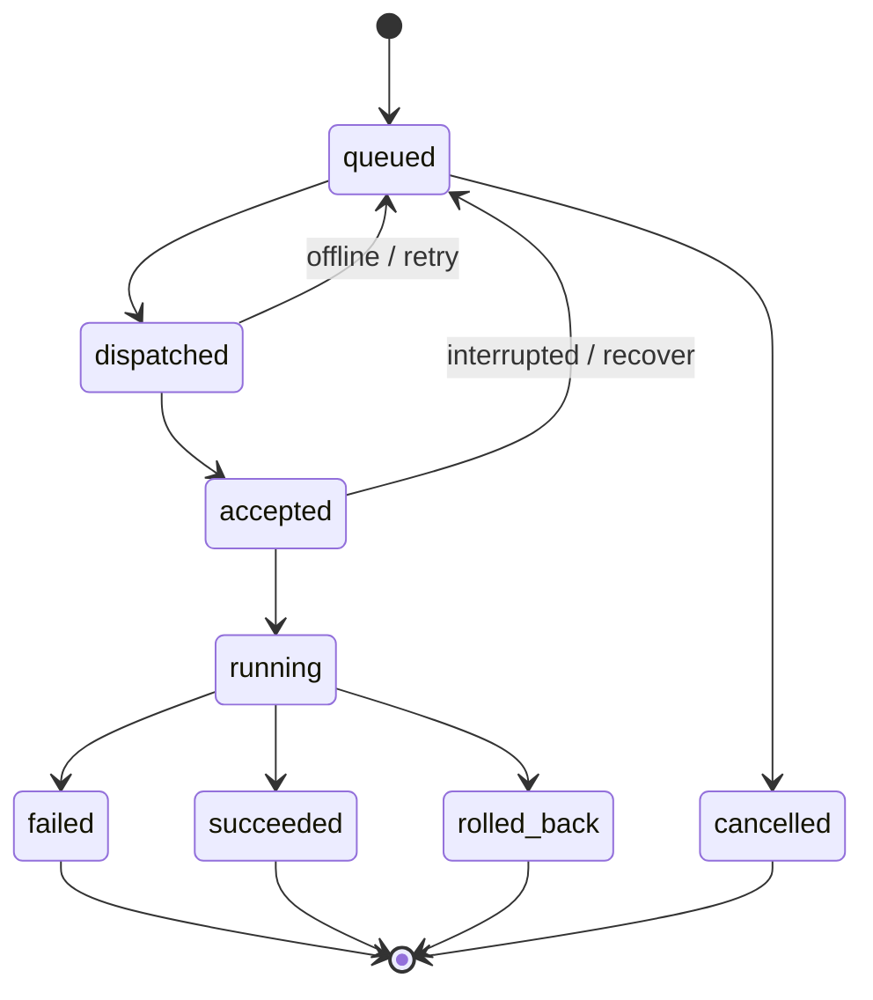

# Panel ↔ Agent 通信协议设计（v1 草案）

> M0 已实现 Enrollment、签名 Session、WSS、hello/heartbeat 和只读 node.inspect 任务。确定性签名编码、限流、兼容边界和实际 API 见 [GETTING_STARTED.md](GETTING_STARTED.md) 与 OpenAPI；本文其他任务和配置类型仍为后续设计。

## 1. 连接拓扑

```text
Agent ---- HTTPS Enrollment/Session ----> Panel
Agent ==== WSS over TLS / 1 outgoing TCP ==> Panel Agent Gateway
Browser ---- HTTPS REST/SSE ------------> Panel API
```

- Panel 不直接访问 Agent 内网端口，适配 NAT VPS/UDP 限制。
- 日常指令、状态、心跳、结果共用一条 TLS/WSS 连接。
- 浏览器 SSE 与 Agent WSS 分离，不把 SSE 作为双向任务通道。
- Agent 不通过 Panel 转发代理业务数据。

## 2. Bootstrap & Enrollment（拟定 API）

1. 管理员填写节点名称和类型，通过 `POST /api/v1/nodes` 创建待注册节点及其一次性令牌（只展示一次，15 分钟有效）。
2. Agent 本地生成 Ed25519 身份密钥对，私钥在本地仅自己可读，绝不上传。
3. Agent 以 HTTPS `POST /api/v1/agents/enroll` 发送令牌、公钥、基本资产和所支持协议版本。
4. Panel 验证令牌并将 Agent Identity 绑定到该令牌所属的已有节点，原子消费令牌；节点 ID 不变，不新增节点。同令牌同公钥在有效期内可恢复丢失响应，其他公钥重放被拒绝。
5. Agent 通过 `POST /api/v1/agents/challenge` 获取短期 nonce，并对绑定域名/Agent ID/nonce/过期时间签名。
6. Agent `POST /api/v1/agents/session` 提交签名；Panel 校验后签发短期会话令牌。
7. Agent 使用 `Authorization: Bearer ...` 在 `GET /api/v1/agents/ws` 的 WSS Upgrade 请求中认证；严禁把凭证放 query string。
8. Gateway 建立连接后进行 `system.hello` / `system.hello_ack` 能力协商。

**实现前必须**补充签名消息的确定性编码、nonce 一次性消费/过期语义、反向代理对 Authorization 头的透传测试。建议初期用标准 HTTPS/WSS 信任链，不允许 `insecure_skip_verify` 生产选项。

## 3. Envelope（唯一结构定义）

权威 JSON Schema：`../api/agent/v1/envelope.schema.json`。样例：

```json
{
  "version": "1.0",
  "message_id": "msg-2001",
  "type": "node.heartbeat",
  "node_id": "node-tokyo-01",
  "sent_at": "2026-10-29T08:00:00Z",
  "payload": {
    "agent_version": "0.1.0",
    "observed_config_revision": 12
  }
}
```

字段：

| 字段 | 必需 | 语义 |
|---|---|---|
| `version` | 是 | 消息协议版本，如 `1.0` |
| `message_id` | 是 | 每条消息唯一 ID，用于追踪/去重 |
| `type` | 是 | `group.action` 形式的消息类型 |
| `sent_at` | 是 | UTC RFC3339 时间；不用作单独的防重放信任依据 |
| `node_id` | 按消息 | 已认证 Node ID，服务端不得仅依赖自报值授权 |
| `correlation_id` | 按消息 | 指向 task/request，串联确认和进度 |
| `revision` | 按消息 | 目标/实际资源版本号，单个资源单调递增 |
| `payload` | 是 | 对应消息类型的数据体，类型、大小、深度须校验 |

协议应配置每帧大小上限、消息速率上限、最大 JSON 深度和队列长度，并拒绝未知操作类型。网络层帧完整不代表业务操作成功。

## 4. 消息类型（建议 v1）

| 方向 | 消息类型 | 用途 |
|---|---|---|
| Agent → Panel | `system.hello` | 协议版本、能力、OS/Arch、可用引擎 |
| Panel → Agent | `system.hello_ack` | 协商结果、心跳间隔、操作权限 |
| Agent → Panel | `node.heartbeat` | 在线状态与观察版本 |
| Agent → Panel | `node.metrics` / `node.metrics_batch` | 协商 v1 单快照 / v2 有界样本批次 |
| Panel → Agent | `task.dispatch` | 明确操作、idempotency_key、deadline |
| Agent → Panel | `task.ack` | accepted/rejected 及原因 |
| Agent → Panel | `task.progress` | 有界百分比/阶段信息 |
| Agent → Panel | `task.result` | 成功/失败/回滚、结构化错误 |
| Panel → Agent | `config.desired` | 期望资源状态/哈希/版本（或安全引用） |
| Agent → Panel | `config.observed` | 实际版本/校验摘要/健康状态 |
| 双向 | `system.error` | 协议级错误，不泄露敏感字段 |

示例文件：`../api/agent/v1/examples/`。

### 4.1 典型任务

```json
{
  "version": "1.0",
  "message_id": "msg-01",
  "type": "task.dispatch",
  "node_id": "node-demo",
  "correlation_id": "task-001",
  "sent_at": "2026-10-29T08:00:00Z",
  "revision": 12,
  "payload": {
    "task_id": "task-001",
    "operation": "proxy.apply",
    "idempotency_key": "node-demo:proxy-01:12",
    "resource_kind": "proxy_service",
    "resource_id": "proxy-01",
    "config_sha256": "aaaaaaaaaaaaaaaaaaaaaaaaaaaaaaaaaaaaaaaaaaaaaaaaaaaaaaaaaaaaaaaa",
    "deadline_at": "2026-10-29T08:05:00Z"
  }
}
```

**安全要求**：`operation` 只能是注册的、强类型参数的枚举操作。禁止 `operation = shell.exec` + 任意字符串。Secret payload 应在短期加密/鉴权通道中按需传递，禁止记录原文日志。

## 5. 任务状态机



- Task 必须先在 DB 记录再派发；对同一资源应串行化有冲突的操作。
- 不保证网络层 exactly-once；目标语义是 **至少一次投递 + 幂等执行 + 最终确认**。
- Agent 将 `task_id / idempotency_key / terminal result` 保存在本地有限期任务日志，收到重复任务直接返回既有结果。
- Panel 重启后恢复未完成任务；不能单凭“发送成功”设为执行成功。
- 长时间运行任务支持进度和超时；超时后需要观察真实服务状态，不应盲目重复变更。

## 6. 配置版本与回滚

- `ConfigRevision` 为不可变快照，按 `(node, resource_kind, resource_id)` 单调递增。
- Panel 将 Desired Revision 与任务置于同一数据库事务中，避免配置存在但任务丢失。
- Agent 验证 expected SHA-256，生成 staged config，运行引擎自带检查，再受控激活。
- 应用后同时检查 **进程正常 + 目标端口/关键服务健康**，成功才报告 Observed Revision。
- 失败恢复最近一个已知成功版本；回滚也可能失败，此时报告 degraded/错误，而不是假装健康。
- 若 Panel 下发旧版本或低于本地已应用 Revision，Agent 必须明确拒绝或进入经授权的 rollback 操作。

## 7. 心跳、断线与背压

初始建议值（可配置，待实际网络验证）：

- heartbeat 30 秒；连续 3 次未在观察窗口内收到则标为 offline（不是停掉代理进程）。
- 新采集设置 v2：采集 0–10 秒（默认 0，随发送采集），WSS 1–5 秒（默认 2），历史提交 30–180 秒（默认 60）；详见 [MONITORING.md](MONITORING.md)。
- 重连：指数退避 + 抖动，设置上下限，避免 Panel 重启后所有 Agent 同时连接。
- 一个 Agent WebSocket 使用单 reader / writer 模式、有限队列；超限时优先丢弃可重建的指标而非任务确认。
- Gateway 应按 Agent 做收发限流，并检查 auth 与 node_id 一致性。
- 如 WSS 被所在网络阻断，后续可提供 HTTPS 长轮询 fallback，但不能降低 TLS 验证或认证标准。

## 8. 版本兼容

- 注册/hello 发送 `protocol_versions`、`engine_capabilities` 与 Agent 版本。
- Panel 按能力下发任务，旧 Agent 接到新操作应明确回复 `unsupported_operation`。
- Envelope 协议版本是公共契约；新增字段首先使用可选属性并添加合约测试；破坏性变更上升 major。
- 与前端 REST API 的版本号分开管理。

## 9. M0 API（已实现，契约以 OpenAPI 为准）

```text
POST /api/v1/agents/enroll
POST /api/v1/agents/challenge
POST /api/v1/agents/session
GET  /api/v1/agents/ws (Upgrade: websocket)
GET  /api/v1/nodes
POST /api/v1/nodes/{id}/tasks
GET  /api/v1/tasks/{id}
GET  /api/v1/events (text/event-stream)
```

请求响应、权限、状态码和分页已在 `api/openapi/openapi.yaml` 定义；配置发布等其他消息仍不支持。
