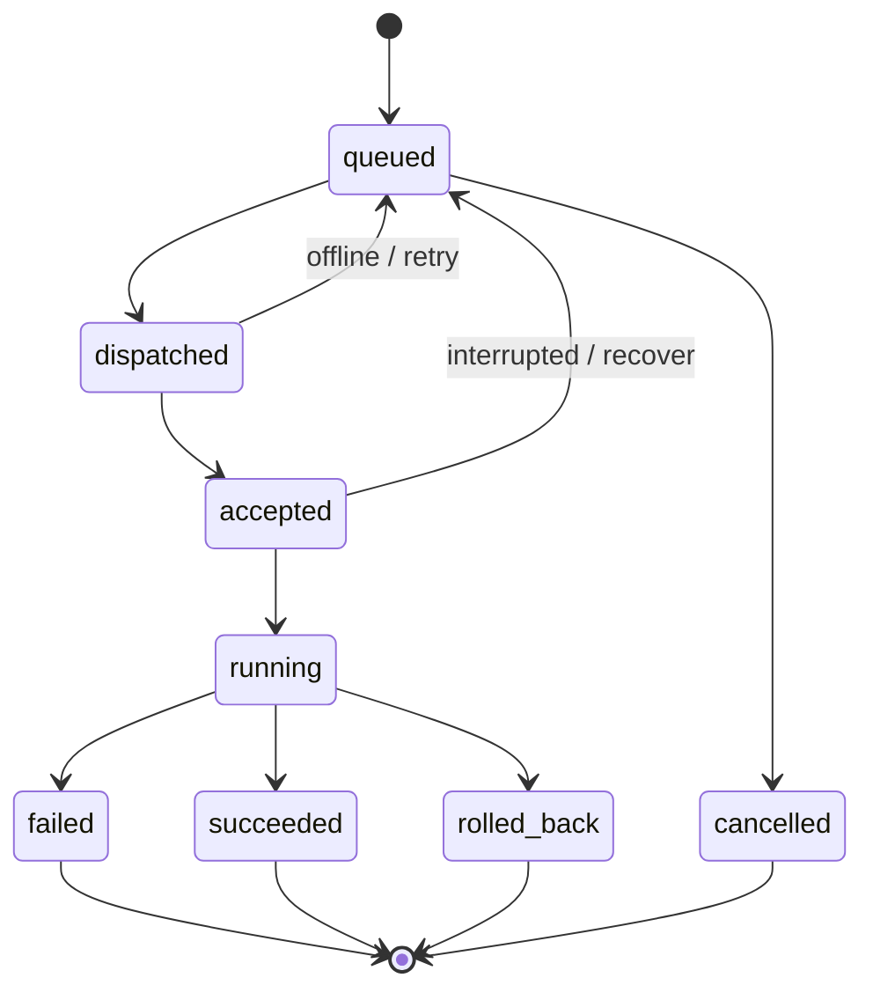

# Panel ↔ Agent 通信协议设计（v1 草案）

> M0 已实现 Enrollment、签名 Session、WSS、hello/heartbeat 和只读 node.inspect 任务。确定性签名编码、限流、兼容边界和实际 API 见 [GETTING_STARTED.md](GETTING_STARTED.md) 与 OpenAPI；本文其他任务和配置类型仍为后续设计。

## 1. 连接拓扑

```text
Agent ---- HTTPS Enrollment/Session ----> Panel
Agent ==== WSS over TLS / 1 outgoing TCP ==> Panel Agent Gateway
Browser ---- HTTPS REST/SSE ------------> Panel API
```

- Panel 不直接访问 Agent 内网端口，适配 NAT VPS/UDP 限制。
- 日常指令、状态、心跳、结果共用一条 TLS/WSS 连接。
- 浏览器 SSE 与 Agent WSS 分离，不把 SSE 作为双向任务通道。
- Agent 不通过 Panel 转发代理业务数据。

## 2. Bootstrap & Enrollment（拟定 API）

1. 管理员填写节点名称和类型，通过 `POST /api/v1/nodes` 创建待注册节点及其一次性令牌（只展示一次，15 分钟有效）。
2. Agent 本地生成 Ed25519 身份密钥对，私钥在本地仅自己可读，绝不上传。
3. Agent 以 HTTPS `POST /api/v1/agents/enroll` 发送令牌、公钥、基本资产和所支持协议版本。
4. Panel 验证令牌并将 Agent Identity 绑定到该令牌所属的已有节点，原子消费令牌；节点 ID 不变，不新增节点。同令牌同公钥在有效期内可恢复丢失响应，其他公钥重放被拒绝。
5. Agent 通过 `POST /api/v1/agents/challenge` 获取短期 nonce，并对绑定域名/Agent ID/nonce/过期时间签名。
6. Agent `POST /api/v1/agents/session` 提交签名；Panel 校验后签发短期会话令牌。
7. Agent 使用 `Authorization: Bearer ...` 在 `GET /api/v1/agents/ws` 的 WSS Upgrade 请求中认证；严禁把凭证放 query string。
8. Gateway 建立连接后进行 `system.hello` / `system.hello_ack` 能力协商。

**实现前必须**补充签名消息的确定性编码、nonce 一次性消费/过期语义、反向代理对 Authorization 头的透传测试。建议初期用标准 HTTPS/WSS 信任链，不允许 `insecure_skip_verify` 生产选项。

## 3. Envelope（唯一结构定义）

权威 JSON Schema：`../api/agent/v1/envelope.schema.json`。样例：

```json
{
  "version": "1.0",
  "message_id": "msg-2001",
  "type": "node.heartbeat",
  "node_id": "node-tokyo-01",
  "sent_at": "2026-10-29T08:00:00Z",
  "payload": {
    "agent_version": "0.1.0",
    "observed_config_revision": 12
  }
}
```

字段：

| 字段 | 必需 | 语义 |
|---|---|---|
| `version` | 是 | 消息协议版本，如 `1.0` |
| `message_id` | 是 | 每条消息唯一 ID，用于追踪/去重 |
| `type` | 是 | `group.action` 形式的消息类型 |
| `sent_at` | 是 | UTC RFC3339 时间；不用作单独的防重放信任依据 |
| `node_id` | 按消息 | 已认证 Node ID，服务端不得仅依赖自报值授权 |
| `correlation_id` | 按消息 | 指向 task/request，串联确认和进度 |
| `revision` | 按消息 | 目标/实际资源版本号，单个资源单调递增 |
| `payload` | 是 | 对应消息类型的数据体，类型、大小、深度须校验 |

协议应配置每帧大小上限、消息速率上限、最大 JSON 深度和队列长度，并拒绝未知操作类型。网络层帧完整不代表业务操作成功。

## 4. 消息类型（建议 v1）

| 方向 | 消息类型 | 用途 |
|---|---|---|
| Agent → Panel | `system.hello` | 协议版本、能力、OS/Arch、可用引擎 |
| Panel → Agent | `system.hello_ack` | 协商结果、心跳间隔、操作权限 |
| Agent → Panel | `node.heartbeat` | 在线状态与观察版本 |
| Agent → Panel | `node.metrics` / `node.metrics_batch` | 协商 v1 单快照 / v2 有界样本批次 |
| Panel → Agent | `task.dispatch` | 明确操作、idempotency_key、deadline |
| Agent → Panel | `task.ack` | accepted/rejected 及原因 |
| Agent → Panel | `task.progress` | 有界百分比/阶段信息 |
| Agent → Panel | `task.result` | 成功/失败/回滚、结构化错误 |
| Panel → Agent | `config.desired` | 期望资源状态/哈希/版本（或安全引用） |
| Agent → Panel | `config.observed` | 实际版本/校验摘要/健康状态 |
| 双向 | `system.error` | 协议级错误，不泄露敏感字段 |

示例文件：`../api/agent/v1/examples/`。

### 4.1 典型任务

```json
{
  "version": "1.0",
  "message_id": "msg-01",
  "type": "task.dispatch",
  "node_id": "node-demo",
  "correlation_id": "task-001",
  "sent_at": "2026-10-29T08:00:00Z",
  "revision": 12,
  "payload": {
    "task_id": "task-001",
    "operation": "proxy.apply",
    "idempotency_key": "node-demo:proxy-01:12",
    "resource_kind": "proxy_service",
    "resource_id": "proxy-01",
    "config_sha256": "aaaaaaaaaaaaaaaaaaaaaaaaaaaaaaaaaaaaaaaaaaaaaaaaaaaaaaaaaaaaaaaa",
    "deadline_at": "2026-10-29T08:05:00Z"
  }
}
```

**安全要求**：`operation` 只能是注册的、强类型参数的枚举操作。禁止 `operation = shell.exec` + 任意字符串。Secret payload 应在短期加密/鉴权通道中按需传递，禁止记录原文日志。

## 5. 任务状态机



- Task 必须先在 DB 记录再派发；对同一资源应串行化有冲突的操作。
- 不保证网络层 exactly-once；目标语义是 **至少一次投递 + 幂等执行 + 最终确认**。
- Agent 将 `task_id / idempotency_key / terminal result` 保存在本地有限期任务日志，收到重复任务直接返回既有结果。
- Panel 重启后恢复未完成任务；不能单凭“发送成功”设为执行成功。
- 长时间运行任务支持进度和超时；超时后需要观察真实服务状态，不应盲目重复变更。

## 6. 配置版本与回滚

- `ConfigRevision` 为不可变快照，按 `(node, resource_kind, resource_id)` 单调递增。
- Panel 将 Desired Revision 与任务置于同一数据库事务中，避免配置存在但任务丢失。
- Agent 验证 expected SHA-256，生成 staged config，运行引擎自带检查，再受控激活。
- 应用后同时检查 **进程正常 + 目标端口/关键服务健康**，成功才报告 Observed Revision。
- 失败恢复最近一个已知成功版本；回滚也可能失败，此时报告 degraded/错误，而不是假装健康。
- 若 Panel 下发旧版本或低于本地已应用 Revision，Agent 必须明确拒绝或进入经授权的 rollback 操作。

## 7. 心跳、断线与背压

初始建议值（可配置，待实际网络验证）：

- heartbeat 30 秒；连续 3 次未在观察窗口内收到则标为 offline（不是停掉代理进程）。
- 监控仅支持 telemetry v3：采集 1–60 秒、HTTP 上报 30–180 秒、WSS 实时上报 1–5 秒；详见 [MONITORING.md](MONITORING.md)。
- 重连：指数退避 + 抖动，设置上下限，避免 Panel 重启后所有 Agent 同时连接。
- 一个 Agent WebSocket 使用单 reader / writer 模式、有限队列；超限时优先丢弃可重建的指标而非任务确认。
- Gateway 应按 Agent 做收发限流，并检查 auth 与 node_id 一致性。
- 如 WSS 被所在网络阻断，后续可提供 HTTPS 长轮询 fallback，但不能降低 TLS 验证或认证标准。

## 8. 版本兼容

- 注册/hello 发送 `protocol_versions`、`engine_capabilities` 与 Agent 版本。
- Panel 按能力下发任务，旧 Agent 接到新操作应明确回复 `unsupported_operation`。
- Envelope 协议版本是公共契约；新增字段首先使用可选属性并添加合约测试；破坏性变更上升 major。
- 与前端 REST API 的版本号分开管理。

## 9. M0 API（已实现，契约以 OpenAPI 为准）

```text
POST /api/v1/agents/enroll
POST /api/v1/agents/challenge
POST /api/v1/agents/session
GET  /api/v1/agents/ws (Upgrade: websocket)
GET  /api/v1/nodes
POST /api/v1/nodes/{id}/tasks
GET  /api/v1/tasks/{id}
GET  /api/v1/events (text/event-stream)
```

请求响应、权限、状态码和分页已在 `api/openapi/openapi.yaml` 定义；配置发布等其他消息仍不支持。


### 浏览器业务及指标 SSE

浏览器与 Panel 使用登录 Cookie 鉴权，当前沿用实例级 viewer/operator/admin 权限；不向浏览器暴露 Agent 凭证。Agent 协议没有变化。

`GET /api/v1/events` 先发送 `snapshot`，内容为 `{"items":[...]}`，表示当前用户最近最多 100 条通知；随后发送 `ready`（`{}`），客户端以此重新同步当前页面的 REST 快照。服务端先订阅再读取快照，读取期间发生的变化保留在队列中。

Web 通知启用实时推送时优先等待 SSE 首次快照，3 秒内未收到有效快照则通过 REST 读取通知；关闭实时推送时直接读取 REST。收到有效快照且连接未中断时，打开通知面板复用本地缓存；连接中断后再次打开面板会重新读取 REST，手动刷新始终可用（读取期间不重复触发打开刷新）。重连快照覆盖缓存，并取消尚未完成的 REST 读取。通知的 100 条保留窗口和服务端差量生成方式不变。

后续仅由实际提交成功的变更触发：

- `notifications`：`{"items":[新增或更新的通知],"removed_ids":[移出窗口的ID]}`；已读状态按用户隔离。
- `change`：`{"kind":"node|nodes|tasks|history|telemetry_settings|telemetry_settings_result|settings","node_id":"可选","node":{可选节点元数据}}`。node 携带当前节点元数据；nodes 表示成员变化；tasks/history 等使对应活动查询失效，按事件重新读取一次。未提交/失败的写入不发布成功事件。
- `closed`：登录失效或 SSE 被关闭，客户端结束连接，不继续自动重连。

`GET /api/v1/metrics/events` 要求恰好一个查询参数：`node=<id>` 返回单节点完整指标，或 `through=<id>` 返回从列表起点至该 ID（包含）的 CPU/内存摘要，最多 1024 个节点。列表 ID 使用与 REST 分页一致的升序；未知、重复、混合参数返回 400，单节点不存在返回 404。

`metrics` 帧结构为 `{reset,items,removed_ids}`，每项包含 `telemetry`、`telemetry_control` 和游标。原始采样位于 `telemetry.points`，最多 600 点、10 分钟；每点的 `group` 标明 `fast` 或 `full`，`sample_sequence` 在所属组内递增，共用 SSE 游标。完整组保留负载、文件系统使用率和进程数的原始采样时间，不按快速组频率重复填充；首次和重连恢复窗口，后续追加。列表省略设备与点窗口。外层 history/points 为空，旧 latest 已移除。缓存代次或游标过期会重置窗口，缺失指标不补零。

所有流每 15 秒发送注释心跳并复核会话和 SSE 设置；这不读取通知、节点列表或指标历史。注销/角色变化等会主动唤醒流重新鉴权，每次业务数据写出前也复核访问权限。现有连接在 SSE 关闭后终止，新连接返回 409。每次数据写入最多 5 秒；全局最多 128 条 SSE 连接。每个订阅最多保存 256 个不同失效键，重复变更合并，溢出要求重新同步。指标在真实事件触发后使用 100ms 一次性窗口合批，不周期扫描数据库。

不提供 Last-Event-ID 持久化回放：重连以通知/指标新快照及 ready 恢复当前状态。任务及历史的权威状态在 SQLite；通知窗口之外和 Panel 重启前未持久化的原始指标不可恢复。旧通知客户端仍可监听 snapshot/notifications，新的 Web 资源需要与新的 Panel 同步部署。反向代理需允许 SSE 长连接、禁用响应缓冲；服务端发送 X-Accel-Buffering: no。


### Telemetry v3 实时需求接线（启动 gate 内）

`/api/v1/metrics/events` 在会话与服务端节点范围校验成功后持有实时需求引用，范围变动时同步增减；关闭流、失效访问或节点删除释放对应引用。同节点多个页面共用一份Agent流，最后引用释放后保留15秒宽限，有新引用则取消退出。普通REST快照/历史和`/api/v1/events`不创建指标需求。全局最多128个需求订阅、1024个节点记录，均为进程内状态，不随Panel重启恢复。

已协商v3且设置已应用的Gateway由唯一writer发送`node.metrics.demand`：90秒TTL、30秒续期、递增revision、当前session generation和lease ID；宽限期间不续期，到期发送停用。匹配回执才记录实际模式，15秒未确认记degraded，停用未确认按30秒预算重试；迟到回执不能倒退新revision。真实SSE+WSS接线已有测试，v3默认启用且前端已接入；完整平台长稳验收仍未完成。

WSS `node.metrics.v3` 还必须属于当前连接上已启用、发送后未满90秒的需求租约。无需求/已停用返回`stale_demand`，已过期返回`lease_expired`；拒绝批次不进入Recorder。无效租约请求计入管理消息限额，不能绕过共享ingress限速。POST不受浏览器需求或实时租约限制，仍单独校验身份、协商、批次和共享上传预算。


### Telemetry v3 REST/SSE 快照

节点详情、节点列表及`GET /api/v1/nodes/{id}/metrics`的monitoring快照新增可选`telemetry`与`telemetry_control`；SSE沿用`MetricFrame.items`。v3数据包含独立fast/full/public_ip、每组received_at/stale、metrics_received_at、实际已应用settings以及嵌套points。整数计数/容量/月流量/设备计数和Agent sample sequence使用十进制字符串，不能用浮点解析后再存回；百分比/速率仍为数值。v3不伪造旧latest/history或同时发送两份曲线。旧监控快照和兼容上报路径已移除。

`management_online`来自节点管理状态；offline不会自动使v3指标stale，也不会因POST上传把节点改成online。fast/full/IP分别按自身观测和接收时间计算新鲜度，重复上传只更新metrics_received_at。客户端需利用时间戳和settings持续判断显示新鲜度；SSE注释心跳不轮询业务数据。列表summary省略接口数组、磁盘 IO 汇总及点窗口。磁盘 IO 使用单个节点汇总对象，开发期旧设备数组不兼容，双方需同步更新。

`telemetry_control`显示http/pending/realtime/degraded、服务端viewer references和租约剩余秒数；启用/续期发送不是确认，模式改变后通过metrics事件刷新。settings仅在Agent applied后进入快照。外层sequence/reset继续作为SSE游标，v3沿用已发布的generation命名空间；重连/协议切换/过旧游标重置窗口。缓存解码错误经REST返回错误或结束SSE，不静默回退旧数据。

容量采集仅上报 `disk_total`、`disk_used`、`disk_available` 三个节点汇总值；文件系统挂载点、格式和容量明细不再进入协议、REST/SSE 或历史响应。Agent 本地保留过滤和去重以避免容量重复累计。开发期移除 `filesystems` 字段，Panel/Agent 需配套更新，不提供旧数据迁移。

## 托管引擎能力

新增可选能力 `engine.manage.v2`，类型化 `engine.install/upgrade/apply/start/stop/uninstall/inspect` 任务以 engine 资源、attempt、修订和命令 SHA-256 关联。旧 Agent 不声明能力时不派发引擎任务。机密参数仅经已认证 WSS 派发，不出现在普通任务查询中。Agent 持久化执行记录，未知结果不盲目重放。详见 [实现验收记录](ENGINE_SERVICES_VALIDATION.md)。

引擎能力 v2 将单值 `EngineService.short_id` 替换为必填 `short_ids` 数组（VLESS 1 至 8 项，Realm 空数组）。每项为 2 至 16 位偶数位十六进制值，忽略大小写去重。REALITY 预设留空时保存两个随机值；引用该预设的服务共享完整列表，sing-box/Xray 同时接受所有值。单条客户端 URI 使用第一项。Envelope 仍为 1.0；v1 引擎能力不再协商，需配套升级 Panel 与 Agent。示例见 `api/agent/v1/examples/engine.apply.json`。
